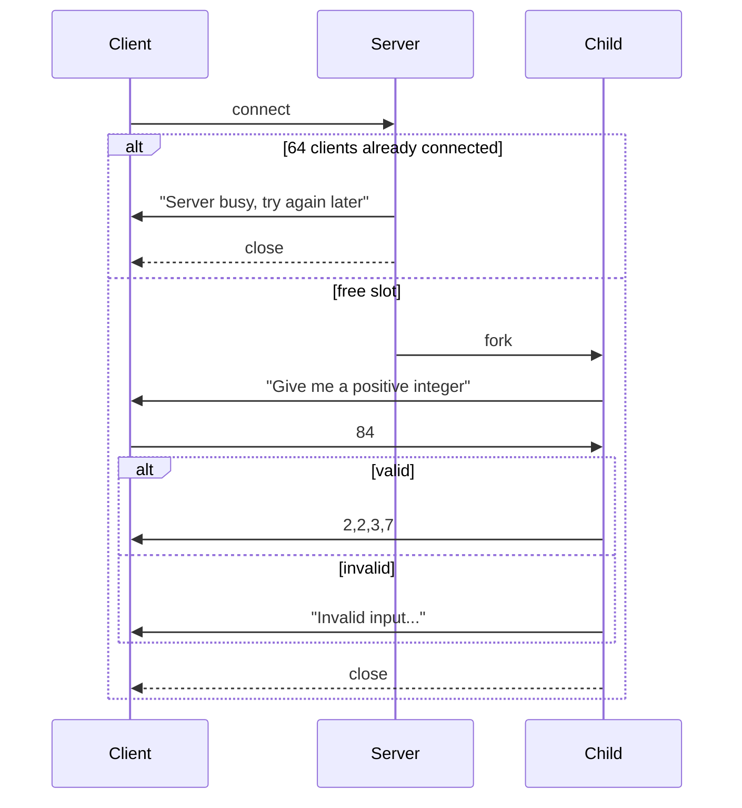

# TCP Prime Factors Server & Client
A C based TCP client–server application that exchanges integers and computes their prime factors. Originally developed as coursework for a distributed systems course at the University of Western Macedonia, now published as a personal repository.

## Overview

This project demonstrates low-level network programming in C using the Berkeley sockets API. It includes both a server and a client:

* **Server**
   * Listens on TCP port `8080` with `SO_REUSEADDR` enabled for quick restarts
   * Forks a child process per connection, capped at 64 concurrent clients; extra clients get a "Server busy" reply instead of an unbounded number of processes
   * Reaps finished children in a `SIGCHLD` handler, so no zombie processes are left behind
   * Gives each client 30 seconds in total (`alarm()`), so idle or slow connections can't hold a process forever
   * Validates input strictly with `strtol`: rejects non-numbers, trailing characters (`12abc`), zero, negatives and values above `INT_MAX`
   * Factorizes by trial division with an overflow-safe bound (`p <= n / p`), so even primes near `INT_MAX` are answered instantly
   * Handles partial reads and writes, since TCP is a byte stream with no message boundaries
   * Keeps serving when a single connection fails, and exits immediately on `SIGTERM`/`SIGINT`
* **Client**
   * Connects to the server at the IP address passed as a command-line argument
   * Checks that the server's greeting matches the protocol before sending anything
   * Validates the number locally and asks again on bad input
   * Prints the server's reply and reports failed system calls with `perror`

## Protocol

One request per connection, as newline-terminated text:

| Step | Direction | Message |
|---|---|---|
| 1 | server → client | `Give me a positive integer` |
| 2 | client → server | an integer from 1 to 2147483647, e.g. `84` |
| 3 | server → client | the prime factors, e.g. `2,2,3,7`, then the connection closes |

Other replies from the server: `Invalid input. Please send a positive integer.` for bad input, `1 has no prime factors`, and `Server busy, try again later` (sent instead of step 1 when 64 clients are already connected).



## Key Concepts Demonstrated

* TCP socket creation, binding, listening, accepting, and bidirectional communication
* Process-per-connection concurrency with `fork()`, file descriptor hygiene in parent and child, and `_exit()` in the child so inherited stdio buffers aren't flushed twice
* Signal handling with `sigaction`: reaping in a `SIGCHLD` handler, blocking `SIGCHLD` around `fork()` to keep the child count race-free, and async-signal-safe handlers for `SIGTERM` and `SIGALRM`
* Defensive input handling: bounded line reads, strict `strtol` parsing and overflow-safe arithmetic
* Error handling that separates per-connection failures (logged, server keeps running) from fatal ones

## Build and run

```bash
make            # builds ./server and ./client with -Wall -Wextra -Wpedantic
./server
```

In another terminal:

```bash
./client 127.0.0.1
```

## Tests

```bash
make test
```

`test.sh` starts the server and checks factorizations (including primes at `INT_MAX`), input validation, the client, the busy reply, zombie reaping, log output and shutdown on `SIGTERM`. It needs Linux and bash. GitHub Actions runs it on every push, builds with `-Werror`, and smoke-tests the Docker image.

## Docker

The multi-stage Dockerfile compiles a statically linked server in a `debian:stable-slim` build stage and copies only that binary into an empty `scratch` image. The final image is about 1 MB, contains no shell, package manager or compiler, and runs as an unprivileged user.

```bash
docker build -t prime-factors-server .
docker run --rm -p 8080:8080 prime-factors-server
```

Then connect from the host as usual:

```bash
./client 127.0.0.1
```

The container exposes port `8080`; the `-p 8080:8080` flag maps it to the same port on the host. The server handles `SIGTERM` itself, so `docker stop` returns immediately.

## Author

Dimitrios Dalaklidis, Informatics graduate (2026) of the University of Western Macedonia, based in Thessaloniki. Backend and systems: open-source contributor to Amazon Ion's `fusion-java` runtime (4 merged PRs), with other projects spanning Spring Boot REST APIs, a FastAPI API gateway with Redis, CI/CD to GHCR and Kubernetes (k3s on Hetzner), and systems programming in C.

Reach me at [dalaklidesdemetres@gmail.com](mailto:dalaklidesdemetres@gmail.com) · [GitHub](https://github.com/DimitriosDalaklidhs) · [LinkedIn](https://www.linkedin.com/in/dimitris-dalaklidis-a72838397/)
